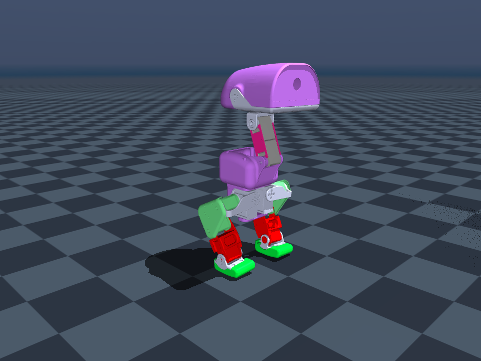
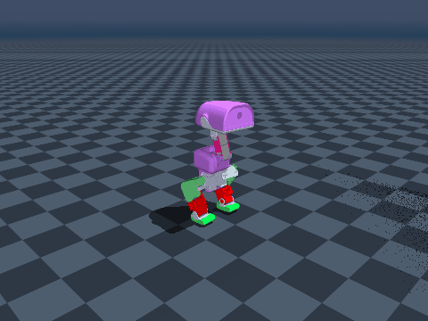

# Momduck

Двуногий робот на 14 сервоприводах **Feetech STS3215 (7.4 В)**, совместимый по
политическому контракту с [Pollen Robotics Microduck](https://github.com/pollen-robotics/microduck_rl)
(61 наблюдение / 14 действий, 50 Гц).

**Автономный репозиторий**: MJCF-модель + STL-меши + обученная ONNX-политика +
раннер на чистых `mujoco` + `onnxruntime`. Ничего из `duck-lab` /
`microduck_local` для запуска не нужно. CAD-исходники не публикуются — только STL.





## Характеристики

| Параметр | Значение |
|---|---|
| Масса | ~1.56 кг в MJCF (реальный робот ~1.5–1.7 кг) |
| Высота | ~0.32 м |
| Степени свободы | 14: ноги 2×5 (hip yaw/roll/pitch, knee, ankle), голова 4 (neck_pitch, head_pitch, head_yaw, head_roll) |
| Актуаторы в модели | position, kp=32, kv=1.5, forcerange ±1.86 Н·м |
| Сервоприводы | Feetech STS3215 7.4 В (параметры BAM m1, см. ниже) |
| Частота управления | 50 Гц (физика 0.005 с × decimation 4) |

## Быстрый старт (Linux / WSL / macOS)

```bash
git clone https://github.com/igorred8/momduck.git
cd momduck
python3 -m venv .venv
source .venv/bin/activate
pip install -r requirements.txt

# интерактивный MuJoCo viewer (на WSL нужен WSLg)
python run_duck.py --vx 0.15
```

Управление в интерактивном режиме (вводить в **терминал**, не в окно):
стрелки ↑/↓ — vx ±0.05 м/с, ←/→ — поворот wz ±0.1 рад/с, пробел — стоп, `q` — выход.

### Headless: видео, GIF, кадры

```bash
MUJOCO_GL=egl python run_duck.py --vx 0.15 --seconds 20 \
    --out media/walk_015.mp4 --gif media/walk_015.gif --stills media
```

- `--azimuth` — ракурс камеры (по умолчанию **135 = спереди-справа**).
- `--track` — камера следит за уткой; без него камера статична и видно
  реальное продвижение по полу.
- `--policy` — другая ONNX-политика; `--scene` — другая сцена.

## Медиа

Фото — статичные, в кейфрейме **STAND**: `stand_front_right.png` (спереди-справа),
`stand_front.png` (анфас), `stand_right.png` (сбоку).

Видео — 20 с ходьбы при команде 0.15 м/с, камера следит за уткой спереди-справа
(без падения, путь 1.62 м, min trunk_z 0.153 м):
[media/walk_015.mp4](media/walk_015.mp4) и [media/walk_015.gif](media/walk_015.gif).

## Политика `policies/momduck_walk.onnx`

- Источник: run **`teach-momduck_walk-b83f5a`** (финал), цепочка warm-start
  PPO (Stable Baselines 3), суммарно **17 401 792 шагов** на CPU.
- Нормализатор наблюдений **запечён в ONNX** (экспорт `export-walk`) — сырые
  SB3-чекпоинты для деплоя не используются.
- sha256: `e1f07fef9116b69b5588118ac520e140c14517b4fb0355241618226e3d5c3ed7`

Замеры финала (детерминированный ONNX, 8 сидов × 20 с, пинкоманда **0.25 м/с**,
чистые условия — без шума/задержки/DR):

| Метрика | b83f5a (эта политика) | e75952@15394k (донор) |
|---|---|---|
| Полных эпизодов 20 с | **8/8** | 8/8 |
| Продвижение по начальному курсу | **+1.61 м** | ~0 м |
| Heading RMSE | **25.8°** | ~110° |
| Lateral RMS | 0.109 м/с | 0.144 м/с |
| Hip yaw L/R | −9.9° / −10.1° (граница ±10°) | −9.5° / −9.5° |

Известные ограничения (честно):
- фактическая скорость ~0.08 м/с при команде 0.25 — ниже команды;
- остаточный боковой дрейф (lat_off до −1 м на части сидов);
- hip yaw стоит на границе ±10°; на одном из 8 сидов походка зеркалится
  (yaw +10°/+10°).

## Контракт `momduck-61-v2`

Наблюдение (61 float, порядок — контракт hot-swap, не менять):

| Слот | Индексы | Содержимое |
|---|---|---|
| `base_ang_vel` | 0:3 | гироскоп `angular-velocity` |
| `projected_gravity` | 3:6 | гравитация в рамке туловища |
| `joint_pos_rel` | 6:20 | qpos − DEFAULT_POSE |
| `joint_vel` | 20:34 | скорости суставов (лаг 1 шаг управления) |
| `last_action` | 34:48 | предыдущее действие (после yaw-ограничения) |
| `twist_cmd` | 48:51 | [vx, vy, wz] |
| `head_pose_cmd` | 51:55 | нули |
| `body_pose_cmd` | 55:61 | нули |

Действие (14 float): `target = DEFAULT_POSE + action` (scale 1.0, радианы),
клип ±4; цели по **hip yaw (индексы 0 и 9) ограничены ±10°** до записи в
`last_action` и до применения. Сброс — keyframe `STAND`.

`run_duck.py` сверен с обучающей средой `microduck_local.MomduckWalkEnv`:
200 шагов независимых прогонов с одной политикой — **траектории qpos совпадают
точно** (одинаковые начальные состояния, нулевые head/body-команды).

## Структура

```
models/            MJCF: model.xml + scene_walk.xml (пол, свет, keyframes)
meshes/            20 STL (визуальные и коллизионные части)
policies/          momduck_walk.onnx (нормализатор внутри)
media/             mp4 / gif / png из симулятора
run_duck.py        standalone-раннер (viewer + headless-запись)
tools/probe_forward.py  оценка политики: N сидов × 20 с, пинкоманда
requirements.txt   mujoco, onnxruntime, numpy, imageio[+ffmpeg], pillow
```

## Дальнейшее обучение: BAM на GPU

Текущая политика обучена на CPU (SB3 PPO) с **XML position-актуаторами**.
Следующий этап — официальный GPU-стек
[`microduck_rl`](https://github.com/pollen-robotics/microduck_rl)
(MuJoCo Warp + mjlab + PPO) с **BAM**-актуаторами
([Rhoban/bam](https://github.com/Rhoban/bam)) — это sim2real-путь.
Репозиторий подготовлен как база для этого: модель, контракт, baseline-политика
и измеритель.

Шаги:

1. Клонировать upstream (нужна **CUDA GPU**):
   `git clone https://github.com/pollen-robotics/microduck_rl`
2. Скопировать `models/` и `meshes/` в
   `microduck_rl/src/mjlab_microduck/robot/momduck/` (по образцу `robot/microduck/`).
3. Параметры **BAM для Momduck** (Feetech STS3215 7.4 В, модель **m1**):
   - параметры мотора: `bam/params/feetech_sts3215_7_4V/m1.json`;
   - `kp_fw = 32.0`, `error_gain = 0.166`, `max_pwm = 0.97`;
   - батарея: `vin` ∈ 7.0–8.2 В, `vin_min = 6.0 В`.
   Эталонная реализация (CPU BAM, самодостаточная):
   `microduck_local/src/microduck_local/robots/momduck_constants.py` и
   `momduck_bam.py` в репозитории `microduck-lab`.
4. Перенести в mjlab cfg экономику наград **v5.4** (оригинальный утиный рецепт +
   `foot_separation`, `stance_sym`, `hip_roll_sym`, `hip_yaw_sym W24`,
   `path_drift W8`, `stride_length W3`, `foot_clearance W3`,
   `forward_progress W6`, `head_tilt`). Термины `hip_pitch_rate` и
   `head_roll_penalty` — **не возвращать**: дважды деградировали походку.
5. Smoke-обучение:
   `uv run train <TASK> --env.scene.num-envs 64 --agent.max_iterations 5`
6. Оценка: upstream `scripts/infer_policy.py --walking <policy>.onnx`
   (умеет BAM-раннер) + `tools/probe_forward.py` из этого репо для
   сопоставимых метрик (полные эпизоды / курс / heading RMSE / yaw).

**sim2real-честность**: приложенная политика — прототип с XML-актуаторами.
На железо ставить политики, переобученные с BAM на официальном стеке.

## История обучения (кратко)

- **Stand**: стабильная стойка 20 с, 24/24 full и goal (наклон 3.2°, дрейф 9 мм).
- **Walk**: цепочка warm-start v2→v5.4; исправлены эксплойты «лежание платит»,
  «крен головы наклоном тела», «пятиться и крутить ногами в воздухе»;
  добавлены термины качества походки и прямолинейности.
- Лучший ранний результат по дистанции: b54594 (v5) +1.53 м / 20 с при 0.15;
  текущая политика b83f5a — +1.61 м при 0.25, курсовая ошибка в 4 раза ниже
  донорской.

## Лицензии и атрибуция

- Код и модель: **Apache-2.0** (см. `LICENSE`).
- Контракт и структура MJCF унаследованы от
  [Pollen Robotics microduck_rl](https://github.com/pollen-robotics/microduck_rl)
  (Apache-2.0). Проект **не аффилирован** с Pollen Robotics.
- Параметры актуаторов: [Rhoban/bam](https://github.com/Rhoban/bam).
- Политика обучена в [`microduck-lab`](https://github.com/igorred8/microduck-lab).
